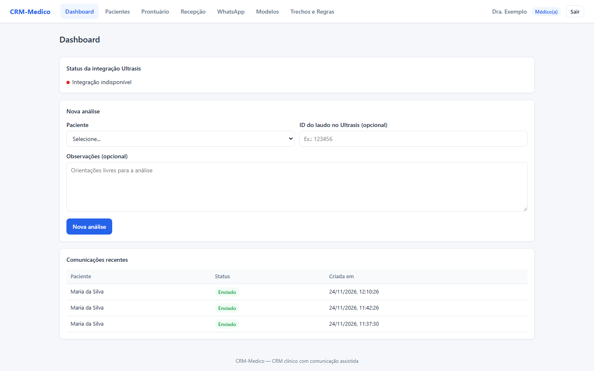
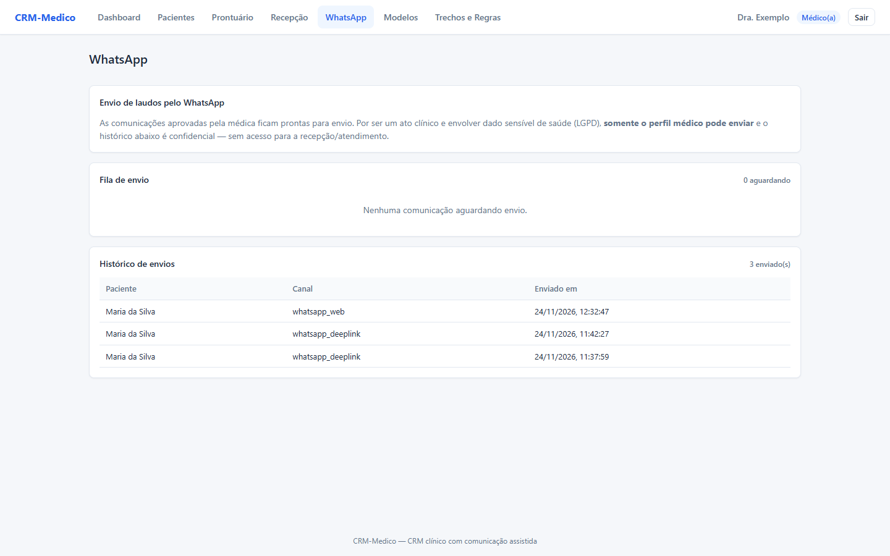

# CRM-Medico

### CRM clínico + comunicação assistida por IA, integrado ao Ultrasis

> Plataforma que transforma laudos de colposcopia (Ultrasis) em **comunicações personalizadas
> e prontas para revisão** — uma em linguagem simples para a paciente e outra técnica para o
> médico solicitante — com **revisão humana obrigatória** e **envio assistido por WhatsApp**.



---

## Visão geral

O **CRM-Medico** complementa o **Ultrasis** (software de gestão de laudos e imagens médicas)
com uma camada de inteligência artificial para **geração assistida de comunicações clínicas**
e um **CRM de atendimento** (pacientes, fila de recepção e prontuário eletrônico).

Após a conclusão do laudo e a chegada dos exames complementares (biópsia, citologia, HPV,
imagens), o sistema gera **duas comunicações para revisão da médica**:

1. **Mensagem à paciente** — linguagem simples, acolhedora e sem jargão técnico.
2. **Mensagem técnica ao médico solicitante** — achados colposcópicos (protocolo IFCPC),
   resultados complementares, interpretação e condutas sugeridas.

> ⚠️ **Human-in-the-loop obrigatório.** Nenhuma mensagem é enviada automaticamente: a médica
> revisa, edita e aprova antes de qualquer disparo.

---

## Destaques

- **Geração assistida por IA** — extração dos laudos + geração de duas mensagens (paciente e técnico).
- **Revisão humana** — workspace de revisão/edição com aprovação antes do envio.
- **Envio pelo WhatsApp** — via deep link `wa.me` (MVP) ou Meta Cloud API (oficial), com confirmação de envio.
- **Prontuário eletrônico** — evoluções no padrão SOAP, histórico clínico e prescrições.
- **Recepção / atendimento** — cadastro de pacientes, agendamento, fila do dia e check-in.
- **Controle de acesso (RBAC)** — hierarquia **Administrador (owner) > Médico(a) > Secretária**,
  com menus e rotas restritos por perfil.
- **Confidencialidade por perfil** — o **envio de laudos é exclusivo do perfil médico**; a
  atendente **não tem acesso** ao histórico clínico nem ao histórico de envios.
- **Segurança e LGPD** — criptografia AES-256-GCM em repouso, pseudonimização antes do LLM e
  trilha de auditoria imutável (*append-only*).

### Telas

**Central de WhatsApp — envio de laudos (exclusivo do médico)**



---

## Stack tecnológica

| Camada | Tecnologia |
|--------|------------|
| Monorepo | pnpm + Turborepo |
| Backend | NestJS (TypeScript) |
| Frontend | React + Vite |
| ORM / Banco | Prisma + SQLite (arquivo local, sem instalação) |
| Contratos | Pacote compartilhado de tipos + zod |
| IA (LLM) | Gateway provider-agnostic (mock / OpenAI / Anthropic / Ollama) |
| WhatsApp | Deep link `wa.me` (MVP) → Meta Cloud API (oficial) |
| Extensão | Extensão de navegador (Chrome) para o WhatsApp Web |
| Autenticação | JWT (access + refresh) + RBAC |
| Deploy | Docker Compose (LAN) / VM na nuvem |

---

## Requisitos

- **Node.js 20 LTS** ou superior
- **pnpm 8+** (`npm i -g pnpm`)
- **Git**
- **SQLite** — embutido no Prisma, **não requer instalação**
- **Docker Desktop** — *opcional* (apenas para Redis/MinIO em recursos de fila/armazenamento)
- Navegador moderno (Chrome/Edge) para uso do sistema e da extensão de WhatsApp

---

## Instalação

```bash
# 1. Clonar o repositório
git clone https://github.com/devt1981/sismed.git crm-medico
cd crm-medico

# 2. Instalar as dependências
pnpm install

# 3. Configurar variáveis de ambiente
cp .env.example .env
#    Edite o .env com: DATABASE_URL, segredos JWT,
#    DOCS_ENCRYPTION_KEY (openssl rand -base64 32) e credenciais do Ultrasis.

# 4. Criar o banco SQLite e aplicar as migrações
pnpm prisma:migrate

# 5. Popular dados iniciais (admin, modelos e regras)
pnpm seed

# 6. Iniciar em modo desenvolvimento (API + Web)
pnpm dev
```

Após subir:

| Serviço | Endereço |
|---------|----------|
| Frontend (Web) | `http://localhost:5173` |
| API | `http://localhost:3000/api` |

### Scripts principais

```bash
pnpm dev            # Desenvolvimento (API + Web)
pnpm build          # Build de produção (todos os pacotes)
pnpm test           # Testes
pnpm lint           # Lint
pnpm prisma:studio  # Prisma Studio (inspeção do banco)
pnpm prisma:migrate # Migrações do banco
pnpm seed           # Dados iniciais
```

### Modos de implantação

| Modo | Onde roda o servidor | Como se acessa |
|------|----------------------|----------------|
| **Local (LAN)** | PC da clínica | `localhost` no servidor; `http://crm-medico.local` nas estações |
| **Nuvem** | VM/servidor na nuvem | Domínio próprio com TLS |

> O **mesmo código** roda nos dois modos; o instalador pergunta *"este PC será o servidor?"*.

---

## Segurança e conformidade (LGPD)

> Dados de saúde são **dados pessoais sensíveis** (LGPD, art. 5º, II) e exigem base legal do art. 11.

- **Criptografia** — TLS 1.2+ em trânsito; AES-256-GCM em repouso (documentos e tokens de integração).
- **Pseudonimização** — antes de enviar conteúdo ao LLM.
- **RBAC com escopo** — secretaria sem acesso clínico; médico restrito ao próprio escopo.
- **Trilha de auditoria imutável** (*append-only*) das operações sensíveis.
- **Minimização de dados** — apenas o necessário é processado/persistido.

---

## Documentação

| Documento | Descrição |
|-----------|-----------|
| [MAPA_DE_IMPLEMENTACAO.md](docs/MAPA_DE_IMPLEMENTACAO.md) | Mapa de implementação: fases, entregáveis, requisitos |
| [mapa-de-implementacao-crm-medico.md](docs/mapa-de-implementacao-crm-medico.md) | Plano detalhado do projeto |
| [proposta-integracao-ultrasis.md](docs/proposta-integracao-ultrasis.md) | Arquitetura e integração com a API Ultrasis v2 |
| [documentacao-api-ultrasis-v2-1.pdf](docs/documentacao-api-ultrasis-v2-1.pdf) | Referência da API Ultrasis v2 |

---

## Sobre este repositório

Este é o **portfólio público** do projeto. Ele publica **apenas a documentação, as imagens e
estas informações de requisitos e instalação**.

O **código-fonte é privado** e **não é versionado aqui** — os diretórios de código
(`apps/`, `packages/`, `infra/` e arquivos de configuração do monorepo) estão
intencionalmente fora deste repositório (ver [`.gitignore`](.gitignore)).

---

## Licença

Projeto **proprietário** — todos os direitos reservados.

## Contato

- **Projeto:** CRM-Medico
- **Versão:** 1.0
