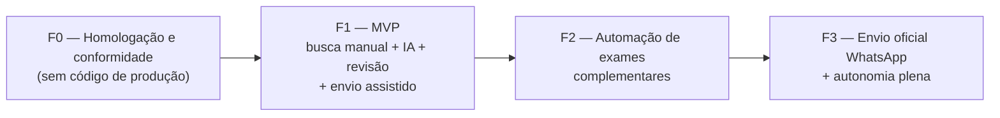

# CRM-Medico — Módulo de Comunicação Clínica Assistida por IA

> **Repositório oficial:** `crm-medico`  
> **Natureza:** CRM clínico + módulo de comunicação assistida por IA, com integração ao Ultrasis

---

## 📋 Visão Geral

O **CRM-Medico** é um sistema que complementa o **Ultrasis** (software de gestão de laudos e imagens médicas) com uma camada de inteligência artificial para **geração assistida de comunicações clínicas**.

### Objetivo Principal

Após a conclusão do laudo de colposcopia e a chegada dos exames complementares (biópsias, citologia, HPV, imagens), o sistema gera **automaticamente duas comunicações para revisão da médica**:

1. **📝 Mensagem acessível à paciente** — linguagem simples, acolhedora, seguindo o padrão de comunicação da clínica
2. **🩺 Mensagem técnica ao médico responsável/solicitante** — achados colposcópicos (protocolo IFCPC), resultados dos exames complementares, interpretação e condutas sugeridas

> **⚠️ Importante:** Nenhuma mensagem é enviada sem **revisão e aprovação humana**. A médica pode editar o texto, inserir medicamentos, orientações e condutas antes do envio pelo WhatsApp.

---

## 🏗️ Arquitetura

```
┌─────────────────────────────────────────────────────────────────────────────┐
│                         CRM-Medico - Módulo de Comunicação Clínica          │
├─────────────────────────────────────────────────────────────────────────────┤
│                                                                              │
│  ┌──────────────┐    ┌──────────────┐    ┌──────────────┐    ┌───────────┐  │
│  │   Ultrasis   │───▶│   Connector  │───▶│  Ingestão &  │───▶│ Armazenamento│  │
│  │   API v2     │    │  (Adapter)   │    │  Normalização│    │  Cifrado    │  │
│  └──────────────┘    └──────────────┘    └──────────────┘    └───────────┘  │
│                                                                              │
│         │                                          │                         │
│         ▼                                          ▼                         │
│  ┌──────────────┐                          ┌──────────────┐                │
│  │   PostgreSQL │◀───┐                  ┌───▶│  Motor de IA │                │
│  │  (Metadados, │    │                  │    │  (Extração + │                │
│  │   Casos,     │    │                  │    │   Geração)   │                │
│  │  Auditoria)  │    │                  │    └──────┬───────┘                │
│  └──────────────┘    │                  │           │                        │
│                      │           ┌──────┴───────┐   │                        │
│         ┌────────────┴──────────▶│ Motor de     │   │                        │
│         │                        │ Modelos/Regras│◀──┘                        │
│         │                        └──────┬───────┘                            │
│         │                               │                                    │
│         ▼                               ▼                                    │
│  ┌──────────────┐                ┌──────────────┐                           │
│  │   Workspace  │◀───────────────│   Geração    │                           │
│  │  de Revisão  │   (Humano no   │  de Rascunhos│                           │
│  │   (Web UI)   │    Loop)       │              │                           │
│  └──────┬───────┘                └──────────────┘                           │
│         │                                                                   │
│         ▼                                                                   │
│  ┌──────────────┐                                                         │
│  │   Envio      │                                                         │
│  │  WhatsApp    │                                                         │
│  │ (Assistido → │                                                         │
│  │  Oficial)    │                                                         │
│  └──────────────┘                                                         │
│                                                                              │
└─────────────────────────────────────────────────────────────────────────────┘
```

### Princípios de Projeto

- **Desacoplamento da integração** (padrão *Adapter*): a IA, os modelos, a interface e o envio não conhecem o Ultrasis
- **Human-in-the-loop obrigatório**: a IA rascunha; a médica revisa e aprova
- **Configuração sem código**: modelos, orientações, condutas e regras são dados, não código
- **Segurança e auditoria por padrão**: criptografia, RBAC, trilha imutável, minimização de dados

---

## 🚀 Stack Tecnológica

| Camada | Tecnologia | Versão |
|--------|------------|--------|
| **Backend** | NestJS | 10+ |
| **Frontend** | React + Vite | 18+ |
| **ORM/DB** | Prisma + PostgreSQL | 16 |
| **Monorepo** | pnpm + Turborepo | atual |
| **Fila/Jobs** | BullMQ + Redis | atual |
| **Armazenamento** | Filesystem local / MinIO | — |
| **OCR/PDF** | Tesseract.js / pdf-parse | — |
| **IA (LLM)** | Gateway provider-agnostic (OpenAI/Anthropic/Gemini/Ollama) | — |
| **WhatsApp** | Deep link `wa.me` (MVP) → Meta Cloud API (oficial) | — |
| **Autenticação** | JWT (access+refresh) + RBAC; argon2id | — |
| **Validação** | zod | — |
| **Testes** | Jest + Supertest + Playwright | — |
| **Qualidade** | ESLint + Prettier + commitlint + husky | — |
| **Deploy** | Docker Compose (LAN) / VM na nuvem | — |
| **Descoberta** | bonjour-service (mDNS) | — |
| **Observabilidade** | pino (logs) + auditoria própria | — |

**Linguagem principal:** TypeScript  
**Runtime:** Node.js 20 LTS

---

## 📦 Estrutura do Repositório (Monorepo)

```
crm-medico/
├─ apps/
│  ├─ api/                 # NestJS (backend + jobs)
│  └─ web/                 # React + Vite (frontend)
├─ packages/
│  ├─ contracts/           # DTOs/tipos + schemas zod (compartilhados)
│  ├─ ui/                  # design system
│  ├─ ultrasis-connector/  # Adapter da API Ultrasis v2
│  ├─ ai-engine/           # extração + geração (provider-agnostic)
│  └─ templates/           # schemas de modelos e regras
├─ infra/
│  ├─ docker/              # docker-compose (api, web, postgres, redis, minio)
│  └─ scripts/             # instalador (pergunta "este PC será o servidor?")
├─ prisma/
│  └─ schema.prisma
└─ docs/
```

---

## 🔄 Fases de Implementação



| Fase | Objetivo Central | Entregável Principal |
|------|------------------|----------------------|
| **F0** | Homologar a integração e fechar conformidade (LGPD, contratos, DPA do LLM) | Relatório de homologação, ADRs, DPA assinado, RIPD/ROPA |
| **F1** | MVP completo: laudo → IA → 2 mensagens → revisão → envio assistido | Aplicação executável nos dois modos (LAN/nuvem) |
| **F2** | Ingestão automática de biópsias/anexos (pasta/e-mail) e polling por período | Documentos chegam automaticamente como pendência de revisão |
| **F3** | Envio pela API Oficial do WhatsApp + autonomia total de modelos/regras | Envio oficial rastreável (entregue/lido) + editor completo |

---

## 📚 Documentação

| Documento | Descrição |
|-----------|-----------|
| [MAPA_DE_IMPLEMENTACAO.md](./docs/MAPA_DE_IMPLEMENTACAO.md) | Mapa detalhado de implementação: fases, tarefas, entregáveis, critérios de aceite, requisitos técnicos, stack, LGPD |
| [PROPOSTA_INTEGRACAO_ULTRASIS.md](./docs/PROPOSTA_INTEGRACAO_ULTRASIS.md) | Proposta técnica e arquitetura: contexto, API Ultrasis, arquitetura, implantação LAN/nuvem |
| [ARQUITETURA.md](./docs/ARQUITETURA.md) | Documento de arquitetura detalhada (decisiones técnicas, ADRs) |
| [LGPD_CONFORMIDADE.md](./docs/LGPD_CONFORMIDADE.md) | Checklist e evidências de conformidade com a LGPD |
| [GUIA_INSTALACAO.md](./docs/GUIA_INSTALACAO.md) | Guia de instalação e configuração (modo LAN e nuvem) |
| [GUIA_DESENVOLVEDOR.md](./docs/GUIA_DESENVOLVEDOR.md) | Guia para desenvolvedores: setup, padrões, workflows |

---

## 🔐 Segurança e Conformidade (LGPD)

> **Dados de saúde são dados pessoais sensíveis (art. 5º, II da LGPD).** O tratamento exige base legal específica do **art. 11** e atenção redobrada.

### Medidas Implementadas

- ✅ **Criptografia:** TLS 1.2+ em trânsito; AES-256-GCM em repouso (documentos e backups)
- ✅ **Pseudonimização** antes de enviar conteúdo ao LLM
- ✅ **RBAC** com escopo (secretaria sem acesso clínico; médico por escopo)
- ✅ **Trilha de auditoria imutável** (append-only) de operações sensíveis
- ✅ **DPA** assinado com provedor de LLM (sem uso dos dados para treino; região; retenção)
- ✅ **Encarregado (DPO)** nomeado; canal de contato publicado
- ✅ **ROPA** e **RIPD/DPIA** elaborados
- ✅ **Política de retenção/eliminação** definida
- ✅ **Plano de resposta a incidentes** (art. 48 LGPD)

### Bases Legais

| Dado | Categoria | Base Legal (LGPD) |
|------|-----------|-------------------|
| Laudos/achados clínicos | **Sensível** | Art. 11, II, "f" — tutela da saúde |
| Identificação (nome, CPF) | Pessoal | Art. 7º, VIII — proteção da saúde |
| Contato (telefone) | Pessoal | Art. 7º, VIII / Art. 11, I (consentimento para canal) |
| Registros de acesso/envio | Log | Art. 7º, X / Art. 16 — obrigação legal/auditoria |

---

## 🖥️ Modos de Implantação

| Modo | Onde roda o servidor | Como se acessa |
|------|----------------------|----------------|
| **Local (LAN)** | PC da clínica (escolhido na instalação) | `localhost` no servidor; `http://crm-medico.local` nas estações |
| **Nuvem** | VM/servidor na nuvem | Domínio próprio com TLS |

> O **mesmo código** roda nos dois modos. O instalador pergunta: *"este PC será o servidor?"*

---

## 🛠️ Como Começar (Desenvolvimento)

### Pré-requisitos

- Node.js 20 LTS
- pnpm 8+
- Docker Desktop
- PostgreSQL 16 (via Docker)
- Redis 7 (via Docker)

### Setup Inicial

```bash
# Clonar repositório
git clone <url-do-repositorio> crm-medico
cd crm-medico

# Instalar dependências
pnpm install

# Subir infraestrutura local
cd infra/docker
docker-compose up -d

# Configurar variáveis de ambiente
cp .env.example .env
# Editar .env com suas configurações

# Rodar migrações
pnpm prisma:migrate

# Iniciar em modo desenvolvimento
pnpm dev
```

### Scripts Principais

```bash
# Desenvolvimento (API + Web)
pnpm dev

# Build de produção
pnpm build

# Testes
pnpm test           # Unitários
pnpm test:e2e       # End-to-end (Playwright)

# Lint & Format
pnpm lint
pnpm format

# Banco de dados
pnpm prisma:studio  # Abre Prisma Studio
pnpm prisma:migrate # Roda migrações
```

---

## 📖 Referências da API Ultrasis

- **Base URL:** `https://apiv2.ultrasis.life`
- **Autenticação:** `Authorization: SEU_TOKEN` (token estático, um por base/cliente)
- **Métodos:** Apenas `GET` (API de leitura)
- **Endpoints:**
  - `GET /status` — Health check
  - `GET /paciente/{cpf}` — Dados do paciente
  - `GET /laudos/{id}` — Lista laudos do paciente
  - `GET /laudo/{id}` — Laudo específico + `pdf_url` (assinado, expira)

> ⚠️ **Lacunas conhecidas:** Sem endpoint de listagem por período; sem anexos/imagens; sem webhook; PDF não estruturado. Ver documentação completa em `docs/PROPOSTA_INTEGRACAO_ULTRASIS.md`.

---

## 🤝 Contribuindo

1. Fork o repositório
2. Crie uma branch: `feature/nome-da-feature` ou `fix/nome-do-fix`
3. Faça suas alterações seguindo [Conventional Commits](https://www.conventionalcommits.org/)
4. Rode os testes: `pnpm test && pnpm test:e2e`
5. Abra um Pull Request

### Padrões de Código

- **Feature-based folders**; injeção de dependência; sem lógica de negócio em controllers
- Cobertura mínima de testes acordada por módulo
- **Secrets nunca no repositório** (uso de `.env` local + cofre em produção)

---

## 📄 Licença

Projeto proprietário — todos os direitos reservados.

---

## 📞 Contato

- **Projeto:** CRM-Medico
- **Cliente:** Dra. / Clínica (usuária de Ultrasis)
- **Documento de referência:** [Mapa de Implementação](./docs/MAPA_DE_IMPLEMENTACAO.md)
- **Versão:** 1.0

---

> **Nota:** Este repositório contém o código-fonte e a documentação técnica do projeto CRM-Medico. Para detalhes de implementação, consulte o [Mapa de Implementação](./docs/MAPA_DE_IMPLEMENTACAO.md) e a [Proposta de Integração](./docs/PROPOSTA_INTEGRACAO_ULTRASIS.md).