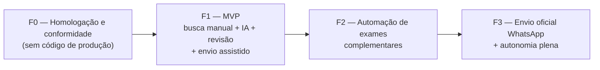

# Mapa de Implementação — CRM-Medico

**Projeto:** CRM-Medico *(sem nome fantasia)*
**Natureza:** CRM clínico + módulo de comunicação assistida por IA, com integração ao Ultrasis
**Documento de referência:** [PROPOSTA_INTEGRACAO_ULTRASIS.md](./PROPOSTA_INTEGRACAO_ULTRASIS.md)
**Versão:** 1.0

---

## 0. Propósito deste documento

Definir **o que construir, em que ordem, com qual tecnologia e sob quais regras legais**. É o
documento de execução a ser seguido pelo time de desenvolvimento. Complementa a proposta técnica
(arquitetura e escopo) com:

1. **Mapa de implementação** — fases, tarefas, entregáveis e critérios de aceite.
2. **Requisitos técnicos** — funcionais e não funcionais.
3. **Linguagem e stack de desenvolvimento** — tecnologias, versões e padrões.
4. **Revisão pela LGPD** — Lei nº 13.709/2018 (proteção de dados), com checklist.

---

## 1. Nome, identidade e convenções

- **Nome oficial do projeto:** `CRM-Medico` — **sem nome fantasia**.
- **Convenções técnicas:**
  - Repositório: `crm-medico`
  - Pacotes internos: `@crm-medico/*`
  - Hostname em rede local: `crm-medico.local`
  - Banco de dados: `crm_medico`
  - Prefixo de tabelas/entidades conforme Prisma (`Paciente`, `Caso`, `Documento`, `Comunicacao`…)

---

## 2. Mapa de implementação — visão geral

Quatro fases encadeadas, cada uma entregando software **utilizável** (não apenas peças).



| Fase | Objetivo central | Pré-requisito |
|---|---|---|
| **F0** | Homologar a integração e fechar conformidade (LGPD, contratos, DPA do LLM) | — |
| **F1** | MVP completo: laudo → IA → 2 mensagens → revisão → envio assistido | F0 |
| **F2** | Ingestão automática de biópsias/anexos (pasta/e-mail) e polling por período | F1 |
| **F3** | Envio pela API Oficial do WhatsApp (Cloud API) + autonomia plena de modelos/regras | F2 |

> **Sem estimativas de prazo neste documento.** Durações e orçamento são definidos na proposta
> comercial, após o desfecho do F0.

---

## 3. Fases detalhadas

### F0 — Homologação e conformidade

**Objetivo:** eliminar incertezas técnicas e legais antes de escrever o núcleo.

**Tarefas**
- Obter **token** da API Ultrasis v2 e validar os 4 endpoints (`/status`, `/paciente/{cpf}`,
  `/laudos/{id}`, `/laudo/{id}`) com dados reais.
- Confirmar com o fornecedor: anexos/DICOM, laudos por período, sandbox, *rate limit*, SLA.
- Definir **encarregado (DPO)**, base legal e assinatura de **DPA** com o provedor de LLM
  (sem uso dos dados para treino; região; retenção).
- Escolher o provedor de LLM e o **modo de implantação** (local/LAN ou nuvem).
- Elaborar **RIPD** e **ROPA** (ver Seção 8).

**Entregáveis:** relatório de homologação da API; decisões registradas (ADRs); DPA assinado; RIPD/ROPA
iniciais.

**Critério de aceite:** os 4 endpoints retornam dados válidos; decisões de arquitetura e bases legais
documentadas.

---

### F1 — MVP (produto utilizável)

**Objetivo:** entregar o fluxo fim a fim de ponta a ponta, com gatilho **manual**.

**Tarefas**
1. **Fundação:** monorepo, CI, Docker Compose (`api`, `web`, `redis`, `minio`) — banco **SQLite** (arquivo, sem instalação).
2. **Autenticação e RBAC:** login, perfis `medico` e `secretaria`, escopo por médico.
3. **CRM/agenda:** cadastro de pacientes (CPF), agenda, origem de CPFs para o *polling*.
4. **Ultrasis Connector:** *adapter* dos 4 endpoints + *polling*/busca idempotente.
5. **Ingestão local:** upload manual, pasta monitorada e e-mail (IMAP) → normalização + OCR.
6. **Armazenamento cifrado** de documentos (origem rastreada).
7. **Motor de IA:** extração estruturada (IFCPC/histopatologia) + geração dos **dois perfis**
   (paciente e médico).
8. **Motor de modelos/regras** configurável pela médica (sem código).
9. **Workspace de revisão:** rascunhos lado a lado, edição, *snippets* de medicamentos/orientações/
   condutas, aprovação.
10. **Camada de envio (assistida):** *deep link* `wa.me` com revisão obrigatória.
11. **Auditoria imutável** e trilha de consentimento/envio.

**Entregáveis:** aplicação executável nos dois modos (LAN/nuvem), documentação de uso e código-fonte.

**Critério de aceite:** com 1 laudo real + 1 biópsia, o sistema gera as duas mensagens, permite edição
e produz o link de WhatsApp — tudo auditado.

---

### F2 — Automação de exames complementares

**Objetivo:** reduzir a ação manual na coleta de biópsias/anexos.

**Tarefas**
- Automatizar a **pasta monitorada** e a **ingestão por e-mail**.
- Ampliar o *polling* para novos laudos por período (quando/já que disponível).
- Casamento automático documento ↔ paciente/caso (matching por CPF + data).
- Notificação de "documento novo para revisar".

**Critério de aceite:** um resultado de laboratório chega por e-mail e aparece como pendência de
revisão no caso correto, sem intervenção manual.

---

### F3 — Envio oficial e autonomia plena

**Objetivo:** envio pela **API Oficial do WhatsApp** e autonomia total da médica.

**Tarefas**
- Integração com **WhatsApp Cloud API** (templates aprovados, *status* de entrega, *opt-in*).
- Canal alternativo de entrega (link seguro do documento quando a política da Meta exigir).
- Editor completo de modelos/regras com versionamento e *preview*.
- Relatórios e métricas de uso.

**Critério de aceite:** envio oficial rastreável (entregue/lido) e criação/alteração de um modelo
completo pela médica, sem desenvolvedor.

---

## 4. Requisitos técnicos

### 4.1 Requisitos funcionais (RF)

| ID | Requisito | Fase |
|---|---|---|
| RF-01 | Integrar a API Ultrasis v2 (paciente, laudos, PDF) | F1 |
| RF-02 | Ingerir documentos por upload, pasta monitorada e e-mail | F1/F2 |
| RF-03 | Extrair achados estruturados (colposcopia/IFCPC, histopatologia) | F1 |
| RF-04 | Gerar mensagem **acessível** à paciente nos padrões da médica | F1 |
| RF-05 | Gerar mensagem **técnica** ao médico responsável (`solicitante`) | F1 |
| RF-06 | Editar mensagens; inserir medicamentos/orientações/condutas | F1 |
| RF-07 | Revisão e aprovação humana obrigatória | F1 |
| RF-08 | Preparar/enviar pelo WhatsApp (assistido → oficial) | F1/F3 |
| RF-09 | Administrar modelos, orientações, condutas e regras sem código | F1/F3 |
| RF-10 | CRM/agenda como fonte única de pacientes e origem de CPFs | F1 |
| RF-11 | Auditoria imutável de acessos, gerações e envios | F1 |
| RF-12 | RBAC: secretaria sem acesso clínico; médico por escopo | F1 |
| RF-13 | Gestão de *opt-in*/consentimento para comunicação | F1/F3 |
| RF-14 | Notificar pendências de revisão | F2 |

### 4.2 Requisitos não funcionais (RNF)

| ID | Categoria | Requisito |
|---|---|---|
| RNF-01 | Segurança | TLS em trânsito; criptografia em repouso (AES-256-GCM) para documentos |
| RNF-02 | Segurança | Senhas com `argon2id`; MFA para perfis médicos (desejável) |
| RNF-03 | Privacidade | Pseudonimização antes de enviar conteúdo ao LLM |
| RNF-04 | Auditoria | Trilha imutável (append-only) de operações sensíveis |
| RNF-05 | Portabilidade | Mesmo código para LAN e nuvem; sem dependência de nuvem específica |
| RNF-06 | Usabilidade | Interface simples; revisão em uma tela; ≤ 3 cliques até aprovar |
| RNF-07 | Desempenho | Geração de mensagem percebida como "rápida" em 1 PC modesto (carga de 2+4 usuários) |
| RNF-08 | Disponibilidade | Serviço na rede local no horário de funcionamento; *backup* automático |
| RNF-09 | Interoperabilidade | Contratos tipados (OpenAPI + zod) entre front e back |
| RNF-10 | Manutenibilidade | Cobertura de testes mínima acordada; lint e formatação obrigatórios |
| RNF-11 | Localização | Português (pt-BR) na interface e nos documentos |
| RNF-12 | Conformidade | Adesão à LGPD (Seção 8) |

---

## 5. Linguagem e stack de desenvolvimento

**Linguagem principal:** **TypeScript** (front e back). **Runtime:** Node.js 20 LTS.

| Camada | Tecnologia | Versão | Justificativa |
|---|---|---|---|
| Backend | **NestJS** | 10+ | Modular, testável, alinhado ao monorepo |
| Frontend | **React + Vite** | 18+ | Simples, rápido, familiar |
| ORM/DB | **Prisma + SQLite** | 3 | Tipagem forte, migrações, auditoria; banco em arquivo, sem instalação |
| Monorepo | **pnpm + Turborepo** | atual | Builds e cache |
| Fila/jobs | **BullMQ + Redis** | atual | *Polling*, OCR, ingestão assíncrona |
| Armazenamento | **Filesystem local / MinIO** | — | Documentos cifrados; LAN ou nuvem |
| OCR/PDF | **Tesseract.js / pdf-parse** | — | Laudos em PDF |
| IA (LLM) | **Gateway provider-agnostic** (OpenAI / Anthropic / Gemini) + opção **Ollama** local | — | Evita *lock-in*; permite modo local |
| WhatsApp | **Deep link (`wa.me`)** (F1) → **Meta Cloud API** (F3) | — | Do MVP ao oficial |
| Autenticação | **JWT (access+refresh) + RBAC**; `argon2id` | — | Segurança e escopo |
| Validação | **zod** | — | Contratos compartilhados |
| Testes | **Jest + Supertest + Playwright** | — | Unidade, integração, e2e |
| Qualidade | **ESLint + Prettier + commitlint + husky** | — | Padronização |
| Deploy | **Docker Compose** (LAN) / VM na nuvem | — | Instalador pergunta: *"este PC será o servidor?"* |
| Descoberta | **bonjour-service (mDNS)** | — | `crm-medico.local` sem IP manual |
| Observabilidade | **pino** (logs) + auditoria própria | — | Diagnóstico e trilha |

**Decisão de IA:** o motor usa **saída estruturada** (JSON *schema*) e um *prompt* com a **biblioteca
de padrões de comunicação** da médica. O provedor é **plugável** e a **pseudonimização** ocorre antes
da chamada.

### 5.1 Padrões de código

- **Conventional Commits**; branches `feature/*`, `fix/*`; PR com revisão obrigatória.
- *Feature-based folders*; injeção de dependência; sem lógica de negócio em controllers.
- Cobertura mínima de testes acordada por módulo; *lint* e *format* no CI.
- **Secrets** nunca no repositório (uso de `.env` local + cofre em produção).

---

## 6. Estrutura do repositório (monorepo)

```
crm-medico/
├─ apps/
│  ├─ api/                 # NestJS (backend + jobs)
│  └─ web/                 # React + Vite (frontend)
├─ packages/
│  ├─ contracts/           # DTOs/tipos + schemas zod (compartilhados)
│  ├─ ui/                  # design system
│  ├─ ultrasis-connector/  # Adapter da API Ultrasis v2
│  ├─ ai-engine/           # extração + geração (provider-agnostic)
│  └─ templates/           # schemas de modelos e regras
├─ infra/
│  ├─ docker/              # docker-compose (api, web, redis, minio)
│  └─ scripts/             # instalador (pergunta "este PC será o servidor?")
├─ prisma/
│  └─ schema.prisma
└─ docs/
```

---

## 7. Requisitos de segurança da informação

- **Criptografia:** TLS 1.2+ em trânsito; AES-256-GCM em repouso (documentos e *backups*).
- **Chaves:** geridas em cofre/KMS; rotação periódica; nunca versionadas.
- **Acesso:** RBAC com escopo; princípio do **menor privilégio**; sessões com expiração.
- **Rede:** apenas o servidor faz chamadas de saída (LLM/WhatsApp); estações não falam com externos.
- **Auditoria:** registro imutável de leitura de documentos, geração de IA e envios.
- **Backup:** automático, cifrado, com **teste de restauração**.
- **Incidentes:** plano de resposta e **comunicação à ANPD e ao titular** (art. 48) quando aplicável.

---

## 8. Revisão pela LGPD (Lei nº 13.709/2018)

> Dados de saúde são **dados pessoais sensíveis** (art. 5º, II). O tratamento exige base legal
> específica do **art. 11** e atenção redobrada.

### 8.1 Papéis
- **Controlador:** a clínica/médica (decide finalidades).
- **Operadores:** CRM-Medico (hospedagem/processamento), provedor de LLM, provedor de WhatsApp.
- **Encarregado (DPO):** nomeado pela clínica (art. 41); canal de contato publicado.

### 8.2 Bases legais
- **Dados sensíveis (saúde):** art. 11, II, "f" — **tutela da saúde**, em procedimento realizado por
  profissionais/serviços de saúde.
- **Dados pessoais correlatos:** art. 7º, VIII (proteção da saúde por serviços de saúde) e demais
  hipóteses aplicáveis.
- **Consentimento (art. 11, I):** registrado para o **canal de comunicação** (WhatsApp), quando não
  coberto pelas hipóteses acima.

### 8.3 Princípios aplicados (art. 6º)
**Finalidade, adequação, necessidade, minimização, qualidade, transparência, segurança, prevenção,
não discriminação e responsabilização.** Na prática: enviar ao LLM **apenas o necessário**
(pseudonimizado), não reter o que não é preciso e documentar cada decisão.

### 8.4 Inventário de dados (o que é tratado)
| Dado | Categoria | Finalidade | Retenção |
|---|---|---|---|
| Identificação (nome, CPF) | Pessoal | Cadastro, envio | Enquanto vigente o vínculo/obrigação legal |
| Laudos/achados clínicos | **Sensível** | Geração de comunicações | Prontuário (prazo legal/CFM) |
| Contato (telefone) | Pessoal | Envio WhatsApp | Enquanto necessário |
| Registros de acesso/envio | Log | Auditoria | Conforme prazo de auditoria |

### 8.5 Direitos do titular (art. 18)
Confirmação, acesso, correção, anonimização, portabilidade, eliminação e informação sobre
compartilhamento — com **fluxo operacional** para atender solicitações.

### 8.6 Transferência internacional (art. 33)
Se o LLM for **no exterior**, exige **mecanismo válido** (país adequado ou **cláusulas contratuais
específicas** previstas pela ANPD) **+ DPA** com vedação de uso para treino e previsão de retenção.
**Alternativa:** usar **LLM local (Ollama)** para eliminar a transferência.

### 8.7 Segurança (arts. 46–49)
Controles da Seção 7. **Art. 49:** sistemas estruturados devem atender aos requisitos de segurança,
prevenção e boa-fé.

### 8.8 Retenção e eliminação (arts. 15–16)
Definir prazos; **eliminar** ao término do tratamento, ressalvadas **obrigações legais** (guarda de
prontuário). Documentos temporários (ex.: cópias de trabalho do LLM) são descartados.

### 8.9 Documentação obrigatória
- **ROPA** — Registro das Operações de Tratamento (art. 37).
- **RIPD/DPIA** — Relatório de Impacto (art. 38), recomendado por tratar dados sensíveis.
- **Encarregado** — indicação e publicação do canal (art. 41).
- **Contratos** — controlador↔operador (art. 39) com o provedor de LLM/WhatsApp.

### 8.10 Checklist de conformidade (LGPD)

- [ ] Base legal documentada (art. 11, II, "f" e art. 7º, VIII)
- [ ] Encarregado (DPO) nomeado e canal publicado
- [ ] ROPA elaborado
- [ ] RIPD/DPIA elaborado
- [ ] DPA assinado com provedor de LLM (sem treino; retenção; região)
- [ ] Mecanismo de transferência internacional (art. 33) definido, se aplicável
- [ ] Pseudonimização antes do LLM
- [ ] Criptografia em trânsito e em repouso
- [ ] RBAC com menor privilégio + MFA (desejável)
- [ ] Trilha de auditoria imutável
- [ ] Política de retenção/eliminação definida
- [ ] Fluxo de atendimento ao titular (art. 18)
- [ ] Plano de resposta a incidentes (art. 48)
- [ ] Consentimento/opt-in registrado para o canal de comunicação

---

## 9. Ambientes e implantação

| Ambiente | Uso | Onde |
|---|---|---|
| **Desenvolvimento** | Time | Máquinas de dev (Docker Compose) |
| **Homologação** | Validação com dados de teste (F0/F1) | LAN ou VM |
| **Produção** | Clínica | **LAN** (PC servidor) **ou** nuvem (VM) |

- **Local (LAN):** instalador pergunta *"este PC será o servidor?"*; servidor publica
  `crm-medico.local`.
- **Nuvem:** mesmo código em VM, com TLS e domínio.

---

## 10. Testes e critérios de qualidade

- **Unidade:** regras de extração, geração e templates.
- **Integração:** connector (mocks da API v2), ingestão (upload/pasta/e-mail).
- **E2E (Playwright):** laudo → IA → edição → aprovação → link de envio.
- **Privacidade:** teste que garante **pseudonimização** antes da chamada ao LLM.
- **Segurança:** varredura de dependências; teste de autorização por perfil.

---

## 11. Ordem de trabalho (sequência de execução)

1. Fundação do monorepo + CI + Docker.
2. Autenticação + RBAC.
3. CRM/agenda (fonte de CPFs).
4. Ultrasis Connector.
5. Ingestão (upload → pasta → e-mail).
6. Motor de IA (extração → geração).
7. Motor de modelos/regras.
8. Workspace de revisão.
9. Envio assistido.
10. Auditoria + relatórios.
11. (F2) Automação de anexos.
12. (F3) WhatsApp oficial + autonomia plena.

---

## 12. Riscos e mitigações

| Risco | Impacto | Mitigação |
|---|---|---|
| Sem endpoint de anexos na API | Médio | Ingestão local (upload/pasta/e-mail) |
| Sem listagem por período | Médio | Origem de CPFs = CRM/agenda |
| Transferência internacional (LLM) | **Alto** | DPA + mecanismo do art. 33 ou **LLM local** |
| Política da Meta p/ conteúdo clínico | Médio | Enviar aviso + link seguro; não trafegar laudo |
| Indisponibilidade do PC servidor (LAN) | Médio | Backup + PC dedicado |

---

## 13. Definição de Pronto (DoD) global

Uma entrega só é considerada pronta quando: compila; passa *lint* e testes; tem documentação atualizada;
respeita RBAC e auditoria; e **não vaza dado sensível** ao LLM sem pseudonimização.

---

## 14. Próximos passos

1. Executar o **F0** (homologação da API + conformidade LGPD/DPA).
2. Aprovar **modo de implantação** (LAN ou nuvem) e **provedor de LLM**.
3. Iniciar o **F1** pela fundação do monorepo e autenticação.
4. Consolidar orçamento, prazos e manutenção na proposta comercial.