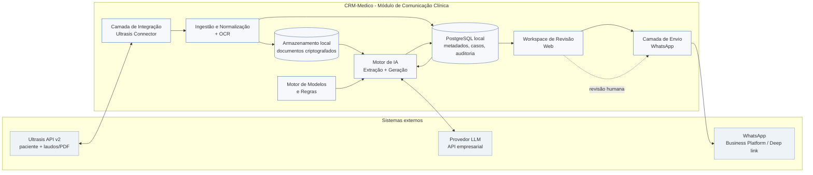
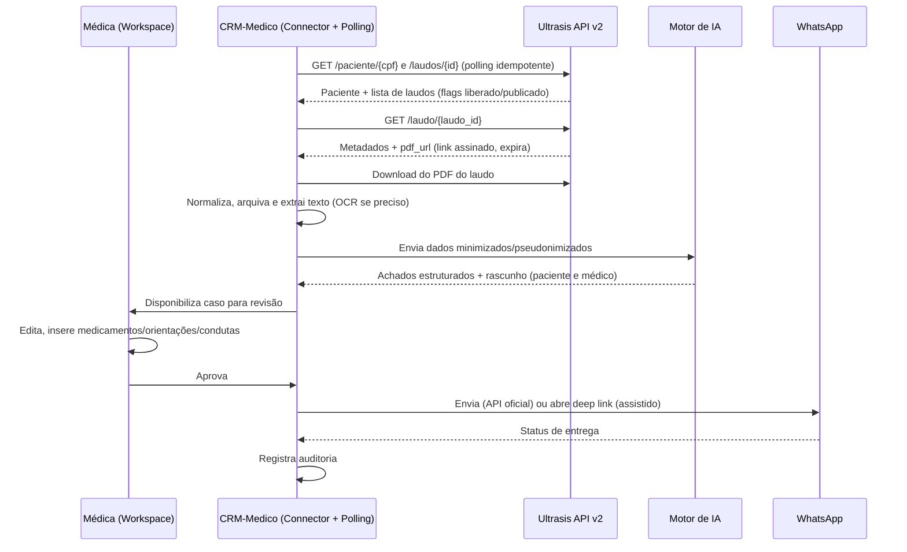

# Proposta Técnica e Arquitetura

## Integração Ultrasis + IA para geração assistida de laudos/comunicações clínicas

**Projeto:** CRM-Medico — Módulo de Comunicação Clínica Assistida por IA
**Cliente:** [Dra. / Clínica] — usuária de Ultrasis (colposcopia, biópsias e exames complementares)
**Versão do documento:** 1.3 (API v2 confirmada + implantação LAN/nuvem + RBAC escopado)
**Status:** Proposta técnica — API de leitura **confirmada e documentada**; restam pontos a homologar (ver Seção 3.2)
**Mapa de implementação:** [mapa-de-implementacao-crm-medico.md](./mapa-de-implementacao-crm-medico.md)

---

## 1. Sumário executivo

O objetivo é criar uma camada de software sobre o sistema **Ultrasis** que, após a conclusão do
laudo de colposcopia e a chegada dos exames complementares (biópsias, citologia, HPV, imagens),
gere **automaticamente duas comunicações para revisão da médica**:

1. Uma **mensagem acessível à paciente**, em linguagem simples e acolhedora, seguindo o padrão de
   comunicação da clínica.
2. Uma **mensagem técnica ao médico responsável/solicitante**, com achados colposcópicos (protocolo
   IFCPC), resultados dos exames complementares, interpretação e condutas sugeridas.

Nenhuma mensagem é enviada sem **revisão e aprovação humana**. A médica pode editar o texto, inserir
medicamentos, orientações e condutas antes do envio pelo WhatsApp.

A viabilidade técnica deixa de ser uma incógnita: a **API do Ultrasis existe, está documentada**
(REST/JSON v2, em `apiv2.ultrasis.life`) e é de **leitura**, autenticada por token, fornecendo dados
do paciente e **o PDF do laudo** (ver Seção 3). O sistema é construído em **camadas desacopladas**,
com um *connector* isolado, de modo que restrições específicas da API (ex.: descoberta de laudos
novos por CPF e ausência de anexos) sejam tratadas sem afetar IA, modelos, interface ou envio.

---

## 2. Objetivo e escopo

### 2.1 Objetivos

- **Reduzir o trabalho manual** de leitura de laudos/exames e de redação de mensagens.
- **Padronizar a comunicação** clínica (paciente e médico), mantendo a voz e os critérios da médica.
- **Garantir segurança e conformidade** (LGPD, sigilo médico, controle de acesso e de envio).
- **Dar autonomia** à médica para alterar modelos, orientações e regras sem depender de
  desenvolvedor.

### 2.2 Dentro do escopo

- Leitura/ingestão de laudos de colposcopia, resultados de biópsia e documentos anexados no Ultrasis.
- Extração estruturada de dados clínicos dos documentos (texto e, quando necessário, OCR).
- Geração assistida por IA de duas mensagens (paciente e médico responsável).
- Interface de revisão, edição e inserção de medicamentos/orientações/condutas.
- Preparação e disparo para WhatsApp (com aprovação humana obrigatória).
- Gestão de modelos, orientações e regras por interface administrativa (autonomia).
- Trilhas de auditoria, controle de acesso e controles de LGPD.
- Documentação técnica e de operação, código-fonte e capacitação para autonomia.

### 2.3 Fora do escopo (nesta fase)

- Assinatura digital de laudos e emissão de receitas com validade farmacêutica.
- Diagnóstico automatizado sem revisão médica (o sistema **apoia**, não decide).
- Faturamento, agenda e gestão financeira.
- Substituição do Ultrasis (o sistema **complementa**, não substitui).

---

## 3. Situação da API do Ultrasis (documentação oficial v2.1 obtida)

> Fonte: PDF oficial **"Documentação da API — Ultrasis API v2"** (6 páginas, fornecida pelo cliente).
> Substitui a pesquisa pública anterior e **remove a incógnita** sobre a existência da API.

**Identificação.** O produto é o **Ultrasis Life** (`ultrasis.life`), software brasileiro de gestão de
laudos e imagens (28+ anos de mercado). Família: Ultrasis Life, Ultrasis Clínica, Ultrasis Vet,
UltraCap e Ultrasis DICOM. Dados em nuvem, com criptografia e backup declarados.

**A API existe e está documentada.** É uma **API REST/JSON v2** com as seguintes características:

- **URL base:** `https://apiv2.ultrasis.life`
- **Métodos:** **somente `GET`** no momento — API **exclusivamente de leitura**.
- **Autenticação:** token estático no cabeçalho `Authorization: SEU_TOKEN`. O **banco do cliente é
  selecionado internamente pelo token** (um token por base/cliente).
- **Sem webhook/evento:** não há endpoint de assinatura de eventos; a leitura é por **polling**.
- **PDF do laudo:** exposto por **link assinado, exclusivo do laudo e com validade (expira)**; o token
  de API **não** abre o PDF diretamente (escopo: um laudo por link).

**Endpoints documentados:**

| Endpoint | Descrição | Conteúdo principal |
|---|---|---|
| `GET /status` | Health check (não exige token) | `success`, `status`, `api`, `time` |
| `GET /paciente/{cpf}` | Dados do paciente pelo **CPF** (com/sem máscara, 11 dígitos) | `id`, `nome`, `nome_social`, `nome_exibicao`, `cpf`, `rg`, `data_nascimento`, `sexo`, `convenio`, `telefone`, `celular`, `email`, `ativo` |
| `GET /laudos/{id}` | **Lista os laudos de um paciente** (pelo `id` do paciente) | `laudo_id`, `pedido`, `exame_id`, `exame`, `titulo`, `data`, `digitado`, `liberado`, `impresso`, `publicado`, `entregue` |
| `GET /laudo/{id}` | **Um laudo específico** (pelo `laudo_id`) | metadados + `solicitante`, `guia`, `rodape` + **`pdf_url`** (assinado, expira) + `paciente` |

**O que a API já cobre:** identificação do paciente (por CPF) e **leitura de laudos** (lista por
paciente + conteúdo/PDF por laudo), com *flags* de status (`digitado`, `liberado`, `publicado`,
`entregue`) úteis para detectar quando o laudo está pronto — inclusive laudos cujo `exame` seja de
colposcopia.

### 3.1 Lacunas da API frente aos requisitos (atenção)

1. **Descoberta de laudos novos (gap principal):** **não há endpoint para listar laudos por
   período** nem "todos os pacientes". Só se chega a um laudo **partindo do CPF/id do paciente**.
   **Contornável localmente:** a origem de CPFs é o **próprio CRM/agenda** (Seção 4.2), sem depender
   de endpoint novo do Ultrasis.
2. **Anexos e imagens:** a API expõe **o PDF do laudo**, mas **não** documenta endpoints para
   **imagens/DICOM nem anexos avulsos**. Se as biópsias forem lançadas como **outro laudo** no
   Ultrasis, ficam acessíveis via `/laudos`; se vierem de laboratório externo, **não** estão na API.
   **Contornável localmente:** ingestão por upload/pasta monitorada/e-mail (Seção 5.2), **sem alterar
   a API**.
3. **Somente leitura:** não é possível **escrever** de volta no Ultrasis (marcar, publicar, enviar).
   O envio por WhatsApp e o controle de pendências ficam **no CRM-Medico**, fora do Ultrasis.
4. **PDF não estruturado:** o conteúdo clínico chega como **PDF**; a extração de achados (IFCPC,
   histopatologia) depende de **IA + parsing de PDF/OCR**, não de campos já estruturados.
5. **Sem sandbox/rate limit documentados:** a doc não menciona ambiente de homologação, dados de
   teste, limites de requisição nem SLA — **a confirmar**.

### 3.2 Perguntas remanescentes ao fornecedor

1. Existe (ou há previsão de) **endpoint para listar laudos por período**, evitando depender de CPF?
2. Como **biópsias/exames complementares** e **anexos/imagens** são representados: laudos, anexos ou
   DICOM? Haverá endpoint para eles?
3. Há **ambiente de homologação** e **massa de testes**, e qual o **rate limit**?
4. Qual o **contrato de tratamento de dados (LGPD)** e o **SLA** da API v2?
5. O token é por cliente/base — confirmar **escopo, rotação e possibilidade de token restrito**.

> Com a API confirmada como **leitura via REST/JSON + PDF**, o **modo primário é o "A. API oficial"**
> (Seção 5.1). Os modos "banco/exportação" e "automação" ficam apenas como **contingência** caso a API
> não cubra anexos/imagens.

---

## 4. Arquitetura proposta (visão geral)

Arquitetura em **camadas desacopladas**, com um *anti-corruption layer* que isola o restante do
sistema das particularidades do Ultrasis. O frontend, o motor de IA e a administração de modelos são
**independentes do modo de integração** escolhido.



**Princípios de projeto:**

- **Desacoplamento da integração** (padrão *Adapter*): a IA, os modelos, a interface e o envio não
  conhecem o Ultrasis; eventuais contingências (exportação/automação p/ anexos) não afetam o núcleo.
- **Human-in-the-loop obrigatório**: a IA rascunha; a médica revisa e aprova.
- **Configuração sem código**: modelos, orientações, condutas e regras são dados, não código.
- **Segurança e auditoria por padrão**: criptografia, RBAC, trilha imutável, minimização de dados.
- **Stack alinhada ao monorepo React + NestJS + Prisma/PostgreSQL**.

### 4.1 Modelo de implantação: local (LAN) ou nuvem, sempre no navegador

O CRM-Medico é **também o CRM da clínica** (fonte de cadastro e agenda). A aplicação é **web (navegador)**
e roda em **dois modos**, com o **mesmo código**:

| Modo | Onde roda o nó servidor | Como se acessa |
|---|---|---|
| **Local (LAN)** | Em um **PC da clínica escolhido na instalação** (o instalador pergunta: *"este PC será o servidor?"*) | Navegador: `localhost` **no próprio servidor**; **endereço do servidor** (IP/`crm-medico.local`) nas demais estações |
| **Nuvem** | Em uma **VM/servidor na nuvem contratado à parte** | Navegador, por **domínio**, com **TLS** |

> **Nota técnica:** `localhost` no navegador funciona **na máquina que roda o servidor**. As **outras**
> estações acessam o mesmo servidor pelo **endereço dele na rede** (ex.: `http://crm-medico.local` ou o
> IP). No modo nuvem, o acesso é pelo domínio. Em ambos os casos, a interface é **no navegador**.

**Topologia do modo local (LAN):** um nó servidor roda banco + serviços + gateway de IA/WhatsApp; as
estações (sala do médico, mesa da secretaria) são **clientes** que falam com o servidor pela LAN.

```mermaid
flowchart LR
    subgraph LAN["Rede local da clínica (LAN)"]
        SRV[(Nó servidor CRM-Medico<br/>DB local + serviços + gateway IA/WhatsApp)]
        DOC[Estações dos médicos<br/>login: médico]
        SEC[Estações das secretárias<br/>login: secretaria]
        DOC <--> SRV
        SEC <--> SRV
        DOC -. descoberta mDNS .-> SRV
        SEC -. descoberta mDNS .-> SRV
    end
    SRV -->|internet (saída)| LLM[Provedor LLM]
    SRV -->|internet (saída)| WA[WhatsApp]
```

- **Descoberta em rede:** o servidor é publicado via **mDNS/zero-config** (`crm-medico.local`); as
  estações o encontram **sem configurar IP manualmente**.
- **Sincronização da agenda:** o **servidor é a fonte única da verdade**. A secretária marca/agenda →
  grava no servidor → a médica vê na estação dela (tempo real via *websocket/SSE* ou *polling*).
- **Acesso externo:** só o **servidor** faz chamadas de saída (LLM e WhatsApp).
- **Disponibilidade:** se o PC escolhido como servidor **desligar**, o sistema fica **indisponível** —
  recomenda-se um PC que permaneça ligado no horário de funcionamento.

**Porte atendido:** **1 clínica**, com até **2 secretárias** e **4 médicos** (várias especialidades) —
carga leve; um único PC modesto atende com folga.

### 4.2 Gatilho de descoberta (MVP): busca manual na consulta

**Gatilho escolhido para o MVP:** quando a paciente **comparece à consulta**, a **médica** abre o
cadastro desse paciente (já existente no CRM-Medico/CRM) e **dispara a busca manual**:

1. CPF do cadastro → `GET /paciente/{cpf}` → `id`.
2. `GET /laudos/{id}` → lista; seleção dos laudos relevantes (colposcopia/biópsia).
3. `GET /laudo/{laudo_id}` → metadados + `pdf_url`; download e arquivamento do PDF.
4. Geração dos rascunhos (paciente e médico) para revisão.

O **agendado (cron)** e a **varredura por período** ficam para depois, **reusando o mesmo motor** de
busca. Detalhes do fluxo de agenda na Seção 4.3.

### 4.3 Fluxo agenda (secretaria → médica)

- A **secretaria** cadastra a paciente e faz a marcação → persistido no servidor.
- A marcação **aparece** para a médica, que pode **acompanhar a agenda**.
- No dia do atendimento, a médica executa a **busca manual** (Seção 4.2).
- O conteúdo clínico (laudos/achados) é **exclusivo da médica** (ver RBAC na Seção 6.1).

---

## 5. Componentes detalhados

### 5.1 Camada de Integração Ultrasis (Connector)

Isola todo o acesso ao Ultrasis atrás de uma interface única (ex.: `getPacientePorCpf`,
`listLaudosPorPaciente`, `getLaudo`, `getLaudoPdf`). **Modo primário confirmado:** API oficial v2
(REST/JSON, **somente leitura**, token no header `Authorization`).

| Item | Realidade confirmada (API v2) | Implicação no *connector* |
|---|---|---|
| Método | Apenas `GET` | Só leitura; nada é escrito de volta no Ultrasis |
| Autenticação | Token estático por base/cliente | Guardar em **cofre**; TLS obrigatório; por ambiente |
| Descoberta | Sem listagem por período; entra por **CPF** → `/paciente` → `/laudos` → `/laudo` | Exige **fonte externa de CPFs** (agenda/CRM) + *polling* idempotente |
| Conteúdo | `pdf_url` **assinado e expirante** (1 laudo por link) | **Baixar o PDF imediatamente** e arquivar; não guardar o link |
| Eventos | Sem webhook | *Polling* com *flags* `liberado`/`publicado` como gatilho |
| Anexos/DICOM | Não documentados | Contingência: exportação ou RPA, se necessário |

**Fluxo do *connector*:** (1) obter CPFs da origem externa; (2) `/paciente/{cpf}` → `id` + dados;
(3) `/laudos/{id}` → lista; filtrar por `exame`/`titulo` (colposcopia/biópsia) e `liberado`/`publicado`;
(4) `/laudo/{laudo_id}` → metadados + `pdf_url`; (5) **baixar o PDF** e arquivar; (6) normalizar.

**Padrões transversais:** idempotência por `laudo_id`, *retry* com *backoff*, fila de falhas
(dead-letter), tratamento do **link expirante** (renovação sob demanda), versionamento de contrato,
separação de credenciais por ambiente e **observabilidade** (logs/métricas de integração).

### 5.2 Ingestão, normalização e armazenamento de documentos

- **Coleta**: *polling* idempotente sobre a API v2 (não há webhook). A lista de CPFs vem do **próprio
  CRM/agenda** da clínica (CRM-Medico) — ver Seção 4.2.
- **Fontes de ingestão — agnósticas de origem:** o **mesmo pipeline** recebe documentos de:
  1. **API Ultrasis v2** (PDF do laudo) — automático por *polling*/busca;
  2. **Upload manual** do PDF/imagem no caso — para biópsias de **laboratório externo**;
  3. **Pasta monitorada** na rede local (o servidor varre uma pasta onde a secretária deposita PDFs) — semi-automático;
  4. **E-mail (IMAP)** — caixa de resultados do laboratório, com anexos ingeridos automaticamente.
  Cada documento registra a **origem** (Ultrasis / upload / pasta / e-mail) para rastreabilidade.
  Isso **contorna a ausência de endpoint de anexos** na API **sem alterar o Ultrasis**.
- **Normalização** para um **modelo canônico interno** (independente do Ultrasis): paciente, laudo
  (`exame`, `titulo`, `data`, status), `solicitante`, PDF arquivado e, quando houver, resultados
  complementares lançados como laudo.
- **Extração de texto**: parsing do **PDF do laudo**; **OCR** (ex.: Tesseract ou OCR gerenciado)
  quando o PDF for digitalizado (imagem sem camada de texto).
- **Armazenamento**: PDFs e derivados em *object storage* com **criptografia em repouso** (AES-256,
  KMS) e **URLs assinadas de curta duração**; metadados e versões no PostgreSQL. **Não** persistir a
  `pdf_url` do Ultrasis (é assinada e expira) — baixar e arquivar a cópia própria.
- **Ciclo de vida**: políticas de retenção e descarte conforme LGPD.

### 5.3 Motor de IA (extração + geração das duas mensagens)

**A) Extração estruturada.** A IA lê o **PDF do laudo** (e demais laudos complementares disponíveis)
e devolve um **JSON estruturado** (schema validado): achados colposcópicos (protocolo **IFCPC**:
epitélio, zona de transformação, achados maiores/menores, impressão geral, etc.), resultados de
biópsia/histopatologia, citologia, HPV e metadados. Saída sempre **validada por schema**; o que não
for reconhecido (ex.: PDF sem texto e OCR de baixa confiança) é sinalizado para revisão humana.

**B) Geração das mensagens.** Dois **perfis de geração** distintos:

- **Paciente** — linguagem simples, acolhedora, sem jargão alarmante, com explicação do que foi
  encontrado, próximos passos e orientações. Adequada a leitura leiga.
- **Médico responsável** — linguagem técnica: achados de colposcopia (IFCPC), resultados dos exames
  complementares, **interpretação** e **condutas sugeridas** quando pertinentes.

**Recursos:** biblioteca de frases/padrões de comunicação da médica aplicada via RAG; *prompts*
versionados; temperatura controlada para previsibilidade; *guardrails* (não inventar dados ausentes,
não emitir diagnóstico não suportado pela fonte, aviso de que o texto é um rascunho sujeito a
revisão). **Minimização/Pseudonimização** de identificadores antes do envio ao provedor de LLM, com
preferência por API empresarial com **retenção zero / sem treinamento** ou modelo auto-hospedado.

### 5.4 Motor de Modelos e Regras (autonomia da médica)

Coração da **autonomia sem desenvolvedor**. Interface administrativa para:

- **Modelos de mensagem** (paciente e médico) com variáveis e *placeholders*.
- **Biblioteca de orientações e condutas** reutilizáveis.
- **Biblioteca de medicamentos** (nome, apresentação, posologia padrão).
- **Regras de negócio**: mapeamento "achado → orientação/conduta sugerida" e regras de escalonamento.
- **Guia de estilo / tom de voz** por destinatário.
- **Versionamento e histórico** de alterações, com autor e data; opção de *workflow* de aprovação.

Tudo persistido como **dados versionados**, não como código, garantindo alteração futura pela própria
médica.

### 5.5 Workspace de Revisão e Edição (interface)

Interface web simples (React), projetada para uso diário e baixo atrito:

- **Painel de casos pendentes** (novos laudos/exames recebidos).
- **Visualização lado a lado**: documentos originais (PDF/imagens) × rascunhos gerados pela IA.
- **Duas abas**: *Mensagem à paciente* e *Mensagem ao médico*, com o mesmo conteúdo-fonte.
- **Editor de texto** com inserção rápida de *snippets* (medicamentos, orientações, condutas).
- **Aprovar / editar / rejeitar / reenviar**; registro da versão final aprovada.
- **Histórico e auditoria** de cada mudança (quem, quando, o quê).

### 5.6 Camada de Envio (WhatsApp)

Distinguir dois caminhos, combináveis:

| Caminho | Descrição | Quando usar |
|---|---|---|
| **Assistido (deep link)** | O sistema monta a mensagem pronta e abre o WhatsApp (`wa.me`) para a médica enviar da própria conta. | **MVP**: menor risco de conformidade, dispensa aprovação de *templates* pela Meta, envio manual em 1 clique. |
| **API Oficial do WhatsApp (Cloud API / BSP)** | Envio programático pelo número oficial da clínica, com *templates* aprovados e status de entrega. | Escala, automação e rastreio. Requer verificação de negócio e aprovação de templates. |

**Restrição importante de conformidade:** as políticas da Meta **não recomendam** trafegar conteúdo
clínico sensível na mensagem. Boa prática: enviar um **aviso de disponibilidade de resultado**
(template categoria *utility*) com **link seguro** para o portal/área do paciente, em vez do laudo em
texto puro. Fora da janela de 24h de atendimento, **somente com template aprovado**. Esses pontos
serão decididos na fase de descoberta.

**Controles:** consentimento/opt-in do paciente, registro de envio, status de entrega, *retry*,
auditoria e possibilidade de **desligar o envio automático** a qualquer momento.

---

## 6. Segurança, LGPD e controle de acesso

Dados de saúde são **dados pessoais sensíveis** (LGPD, art. 5º, II). O tratamento exige base legal
adequada, segurança e governança.

**Base legal e governança.** Provável enquadramento na **tutela da saúde** (LGPD, art. 11, II, "f"),
por profissionais de saúde; comunicação por WhatsApp depende de **consentimento** e informação clara
ao titular. Elaborar: **ROPA** (registro das operações), **RIPD/DPIA** (avaliação de impacto) e
**contratos de tratamento** entre as partes (Ultrasis e provedor de IA atuando como **operadores**;
clínica como **controladora**).

**Medidas técnicas:**

- **Criptografia** em trânsito (TLS 1.3) e em repouso (AES-256, KMS).
- **RBAC** (médica, secretária, administrador) + **MFA**; princípio do menor privilégio.
- **Auditoria imutável** de acessos, edições e envios.
- **Minimização de dados** e **pseudonimização** antes do provedor de LLM.
- **Preferência por região Brasil** para armazenamento/residência de dados.
- **Gestão de segredos** (cofre), segregação de credenciais por ambiente.
- **Direitos do titular**: acesso, correção, portabilidade e eliminação.

**Medidas organizacionais:** treinamento de uso, política de retenção, plano de resposta a
incidentes e designação de encarregado (DPO).

### 6.1 Papéis e permissões (RBAC)

| Papel | Pode | Não pode |
|---|---|---|
| **Médico(a)** | Ver exames/laudos/PDFs, revisar/editar/aprovar mensagens, inserir medicamentos/condutas | Administração de infraestrutura |
| **Secretária** | Cadastro de pacientes, agenda/marcações, dados administrativos (nome, telefone de contato) | **Visualizar laudos/exames/PDFs ou qualquer conteúdo clínico** |
| **Administrador** | Configurar modelos/regras, usuários e parâmetros | — |

Regras: autorização por papel **em nível de endpoint e de campo**; o conteúdo clínico (laudos, PDFs,
achados, mensagens) é **exclusivo dos médicos autenticados**. Com **4 médicos de especialidades
diferentes**, o acesso é **escopado ao médico**: cada médico vê apenas os casos/exames dos **seus
pacientes/atendimentos** (não os de outro especialista). A "mensagem ao médico responsável" é
endereçada ao **`solicitante` do laudo** (campo já retornado por `/laudo/{id}`). **Secretárias não
acessam conteúdo clínico.** Toda leitura é **auditada**; sessão autenticada obrigatória; **MFA** para
perfis sensíveis.

### 6.2 Dados locais, residência e LGPD

- **Residência:** os dados clínicos permanecem **na clínica** (banco local) — simplifica a
  transferência internacional (LGPD, art. 33), mas **não dispensa** contrato de tratamento.
- **Em repouso:** **criptografia de disco** (BitLocker/LUKS) + criptografia do banco/arquivos;
  controle físico do nó servidor.
- **Backup:** cópia **criptografada** e **testada** (mídia/máquina local segura), com política de
  retenção e **restauração verificada**.
- **Saída para IA:** só a médica dispara; envio **minimizado/pseudonimizado** ao provedor de LLM
  (operador), com contrato e preferência por **retenção zero**; **opção de LLM local** para nenhum
  dado sair da clínica.
- **Trilha de auditoria imutável:** quem acessou o quê e quando.

---

## 7. Fluxo ponta a ponta



---

## 8. Modelo de dados (entidades principais)

- **Paciente** (dados mínimos; pseudônimo interno; `id` e `cpf` do Ultrasis).
- **Laudo** (`exame`, `titulo`, `data`, status, `solicitante`, origem Ultrasis).
- **DocumentoLaudo** (PDF arquivado: storage key, hash, texto extraído/OCR, versão).
- **ResultadoComplementar** (biópsia, citologia, HPV — quando lançados como laudo).
- **CasoComunicacao** (vínculo exame + paciente + status).
- **Mensagem** (perfil: paciente/médico; conteúdo; versão; aprovador; timestamp).
- **ModeloMensagem** e **RegraClínica** (versionados).
- **BibliotecaOrientacao**, **BibliotecaMedicamento**.
- **Envio** (canal, status, timestamp, id externo).
- **Auditoria** (ator, ação, entidade, antes/depois, timestamp).
- **Consentimento** (titular, canal, data, origem, revogação).

---

## 9. Requisitos não funcionais

- **Segurança/LGPD**: conforme Seção 6.
- **Disponibilidade**: filas e *retry* para não perder eventos de laudo.
- **Rastreabilidade**: toda mensagem final ligada a um caso e a um aprovador humano.
- **Portabilidade**: troca de provedor de LLM e de canal WhatsApp sem refazer o núcleo.
- **Observabilidade**: logs, métricas e alertas de integração e de geração.
- **Usabilidade**: revisão e envio em poucos cliques; interface limpa e clara.

---

## 10. Roadmap por fases

Com a API v2 confirmada (leitura REST/JSON + PDF), o **F0 deixa de ser bloqueador de viabilidade** e
passa a ser **homologação e resolução de lacunas** (descoberta por CPF, anexos, sandbox, LGPD).

| Fase | Entrega | Dependência |
|---|---|---|
| **F0 — Homologação e conformidade** | Testes reais na API v2 com amostras **anônimas**; definição da **origem de CPFs**; RIPD/ROPA; resposta às lacunas 3.1/3.2. | Acesso a token/API |
| **F1 — MVP** | Connector v2 (paciente/laudos/PDF) + *polling*; **ingestão local** (upload/pasta/e-mail); motor de IA (extração + 2 mensagens); workspace de revisão; **envio assistido** por deep link; autonomia básica de modelos. | F0 |
| **F2 — Automação de exames complementares** | Automatizar a ingestão de biópsias/anexos (**pasta monitorada/e-mail**); cobrir anexos adicionais se a API os expuser; ampliar o *polling* por período. | F1 |
| **F3 — Envio oficial + autonomia plena** | **WhatsApp Cloud API** com templates; administração completa de modelos/regras; painel de indicadores. | F1/F2, verificação Meta |

Cada fase é entregável e utilizável isoladamente.

---

## 11. Escopo do entregável (documentação, código e autonomia)

- **Código-fonte** em repositório do cliente, com histórico e CI/CD.
- **Infraestrutura como código** (IaC) e configuração por ambiente.
- **Documentação**: propósito, requisitos, arquitetura, instalação (passo a passo), operação,
  administração de modelos/regras, segurança/LGPD e solução de problemas.
- **Capacitação** da equipe para operar e ajustar modelos/regras sem desenvolvedor.
- **Transferência de conhecimento** e período de acompanhamento pós-implantação.

---

## 12. Manutenção futura e modelo de custos

### 12.1 Modelo de manutenção

- **Sustentação**: correções, atualização de dependências, monitoramento e suporte.
- **Evolução contínua**: novos modelos/regras, ajustes de IA e melhorias de UX.
- **Adaptação a mudanças do Ultrasis**: ajuste do connector quando o fornecedor alterar a API/telas.
- **Níveis de serviço (SLA)**: a definir (janela de atendimento, tempo de resposta, severidade).

### 12.2 Estrutura de custos (o que compõe o valor)

| Item | Natureza | Observação |
|---|---|---|
| Implantação (F0–F3) | Único | Dimensionada após F0 |
| Infraestrutura (local ou nuvem) | Único + manutenção | PC/nó servidor da clínica **ou** VM na nuvem; no modo local, dados na clínica |
| Consumo de LLM | Variável | Dependente de volume de exames e tokens |
| WhatsApp (Cloud API/BSP) | Recorrente | Tarifas por conversa/template da Meta/BSP |
| API do Ultrasis v2 | Recorrente/contratual | Acesso por **token**; confirmar custo/termos com o fornecedor |
| Manutenção/suporte | Recorrente | Conforme SLA e escopo de evolução |

> **Observação de transparência:** valores, prazos e portfólio definitivos devem ser apresentados
> pelo fornecedor que executará o projeto, pois dependem de (a) desfecho da due diligence do Ultrasis
> e (b) acordo comercial. Este documento entrega o **escopo técnico** que fundamenta esse orçamento.

---

## 13. Estimativa preliminar de esforço (a confirmar após F0)

Sizing **relativo** por módulo (homem-dia, faixa preliminar, sujeita a F0). Não constitui prazo
calendário nem proposta comercial fechada.

| Módulo | Faixa (homem-dia) |
|---|---|
| F0 — Homologação da API v2, dados e conformidade | 8–15 |
| Ingestão + armazenamento + OCR | 10–18 |
| Motor de IA (extração + 2 perfis de geração) | 15–25 |
| Workspace de revisão/edição | 12–20 |
| Motor de modelos/regras (autonomia) | 8–14 |
| Envio WhatsApp (assistido → oficial) | 5–12 |
| Segurança, auditoria, LGPD e testes | 10–18 |
| Documentação e capacitação | 5–8 |

---

## 14. Riscos e mitigações

| Risco | Impacto | Mitigação |
|---|---|---|
| Descoberta de laudos sem listagem por período (dependência de CPF) | Alto | Fonte externa de CPFs (agenda/CRM); *polling*; cobrar endpoint por período |
| Políticas da Meta p/ conteúdo clínico | Alto | Não trafegar laudo no texto; aviso + link seguro; templates |
| Exatidão da IA | Alto | Revisão humana obrigatória; saída validada por schema; *guardrails* |
| Conformidade LGPD incompleta | Alto | RIPD/ROPA; contratos; pseudonimização; região BR |
| Qualidade de OCR em digitalizados | Médio | OCR + revisão; sinalização de baixa confiança |
| Mudanças de tela/fluxo do Ultrasis | Médio | Preferir API/exportação; testes de contrato |
| Segurança de credenciais/segredos | Médio | Cofre de segredos; menor privilégio; MFA |

---

## 15. Premissas, dependências e perguntas em aberto

**Premissas**

- A API v2 é **somente leitura**; todo controle de pendência/envio vive no CRM-Medico.
- A médica é **controladora** dos dados; o sistema atua como **operador**.
- A revisão humana é **sempre** obrigatória antes do envio.
- Há **token de API** ativo e autorização da médica para acessar os dados no Ultrasis.
- Existe uma **origem de CPFs** (agenda/CRM) para o *polling*.

**Dependências**

- Respostas às lacunas e perguntas das Seções 3.1 e 3.2.
- Definição da **origem dos CPFs** para descoberta de laudos.
- Definição do canal WhatsApp (assistido vs. Cloud API).
- Aprovação jurídica de RIPD/ROPA e contratos de tratamento.

**Perguntas em aberto**

1. Volume médio de exames/mês (dimensiona custo de IA e WhatsApp)?
2. Qual sistema detém a **lista de pacientes/CPFs** para alimentar o *polling*?
3. Preferência por **envio assistido** (1 clique na conta da médica) ou **envio automático** por
   número oficial?
4. Os exames complementares (biópsias) chegam **dentro** do Ultrasis (como laudo) ou por outro
   laboratório/sistema?
5. A médica já possui **nº oficial WhatsApp Business** e conta Meta Business Manager?
6. Requisitos de região de dados (obrigatoriamente Brasil)?

---

## 16. Próximos passos

1. **Aprovar** esta proposta e o escopo.
2. **Validar o token** da API v2 e testar `/status`, `/paciente/{cpf}`, `/laudos/{id}` e
   `/laudo/{id}` com CPFs de teste.
3. **Encaminhar** ao fornecedor as perguntas remanescentes (Seção 3.2).
4. **Definir** a **origem de CPFs** e o canal de WhatsApp (assistido no MVP; oficial depois).
5. **Iniciar F0** com amostras **anonimizadas** de laudos de colposcopia/biópsia p/ provar a extração.
6. **Consolidar orçamento e prazo** com base no desfecho do F0.

---

## 17. Matriz de rastreabilidade dos requisitos

**Legenda:** ✅ atendido · ⚠️ parcial (contornável com dados locais e/ou fase posterior) · ❌ fora do
escopo técnico (item comercial)

| # | Requisito | Status | Onde | Observação |
|---|---|---|---|---|
| 1 | Acessar **automaticamente** laudos de colposcopia, biópsias e outros anexos | ⚠️ Parcial | 3, 5.1, 5.2 | Laudos ✅ via API v2; biópsias/anexos ✅ via **ingestão local** (upload/pasta/e-mail). "100% automático" só com pasta monitorada/e-mail |
| 2 | IA interpreta e gera mensagem à paciente nos padrões | ✅ | 5.3-B, 5.4 | — |
| 3 | Editar mensagens e acrescentar medicamentos/orientações/condutas | ✅ | 5.4, 5.5 | — |
| 4 | Preparar envio WhatsApp após revisão/aprovação | ✅ | 5.6, 7 | Aprovação humana obrigatória |
| 5 | 2ª mensagem técnica ao médico responsável | ✅ | 5.3-B, 6.1 | Endereçada ao `solicitante` do laudo |
| 6 | Mensagens diferentes por destinatário | ✅ | 5.3, 5.5 | Dois perfis de linguagem |
| 7 | Autonomia p/ alterar modelos/orientações/regras | ✅ | 5.4 | Configuração por interface, sem código |
| 8 | Integração por API, com confirmação de disponibilidade | ✅ | 3, 5.1 | API v2 **confirmada** (leitura) |
| 9 | Segurança, dados médicos, LGPD, controle de acesso e envio | ✅ | 6, 6.1, 6.2 | RBAC escopado + auditoria |
| 10 | Fornecedor com experiência (API/IA/automação/UI) | ❌ | — | Item **comercial**, não de sistema |
| 11 | Orçamento, prazo, exemplos, manutenção | ⚠️ | 12.1, 12.2, 13 | Manutenção ✅; custos = estrutura; **valores/prazo/portfólio** a cargo da proposta comercial |
| 12 | Entrega com documentação, código-fonte e autonomia | ✅ | 11 | — |
| 13 | Objetivo final: duas comunicações **automáticas** após laudo + exames complementares | ⚠️ | 1, 4.2, 10 | Duas mensagens ✅; "automaticamente" = **fase posterior** (cron F2/F3). No MVP o gatilho é **manual**, por decisão do cliente |

**Nota 1 — Automação plena é fase posterior.** No MVP (F1) o gatilho é a **busca manual** na consulta
(decisão do cliente). A geração **automática** (sem ação humana para disparar) e a **detecção de
exames complementares** por período entram nas fases **F2/F3** (agendado/cron), reusando o mesmo
motor.

**Nota 2 — Lacunas contornáveis com dados locais.** As restrições da API v2 são cobertas
**localmente**, sem alterar o Ultrasis:

- **Descoberta:** a fonte de CPFs é o **próprio CRM/agenda** (Seção 4.2).
- **Biópsias/anexos externos:** ingestão por **upload manual**, **pasta monitorada** ou **e-mail
  (IMAP)** (Seção 5.2).
- O envio pelo WhatsApp e o controle de pendências vivem no **CRM-Medico** (a API é somente leitura).

**Nota 3 — Itens comerciais.** Este documento é **técnico**. Valores de orçamento, **prazo
calendário** e **exemplos de trabalhos semelhantes** devem ser fornecidos na **proposta comercial** de
quem executar (ver Seção 12.2).
